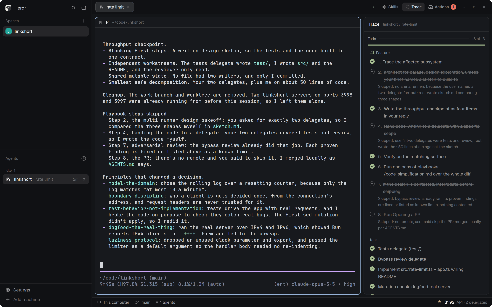
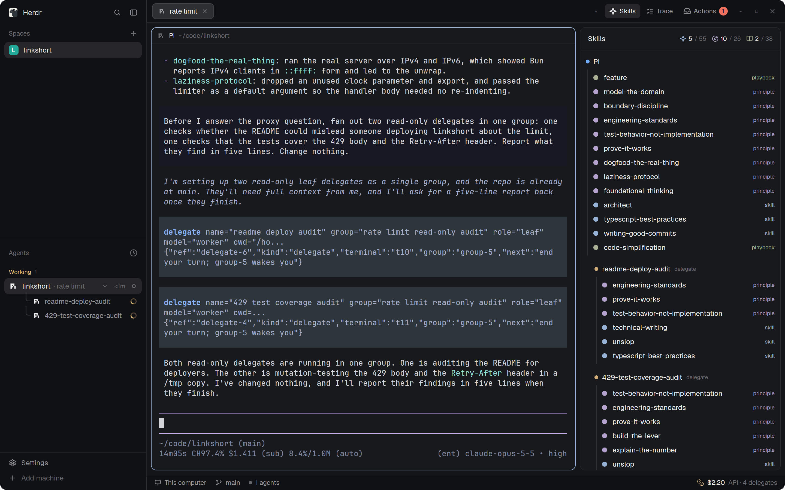
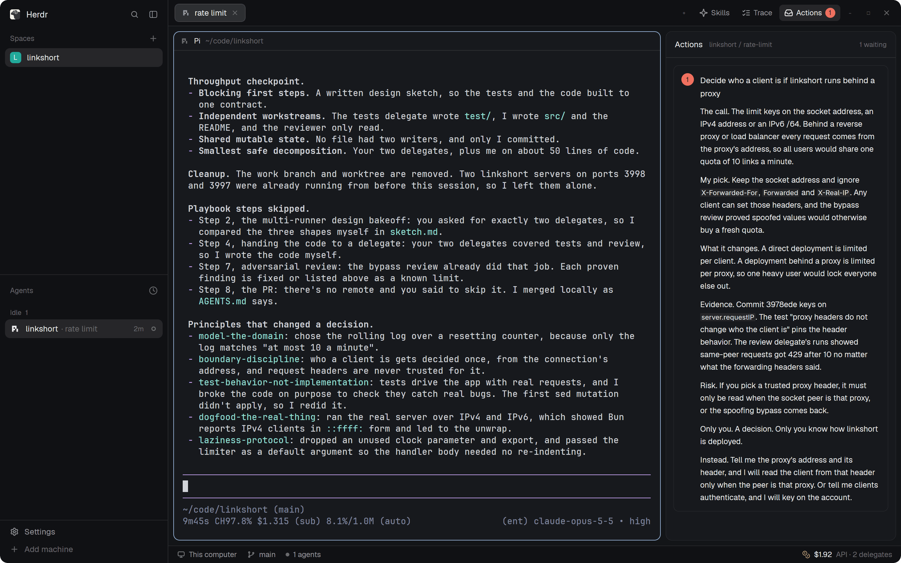

# pi-harness

**Agents that plan with you, work while you're away, and show every step.**

pi-harness is a config folder for the [pi](https://github.com/earendil-works/pi) coding agent, plus panels for the [Herdr](https://herdr.dev/) terminal app. You say what you want in plain words. The agent picks a workflow, agrees the plan with you, builds it with helper agents, and proves it works before it calls the job done.



- **Proof, not claims.** Done means a run: the tests, the app driven like a user, and a review by a model from another vendor.
- **You keep the big calls.** It works alone when you tell it to, but force-pushes, deploys, deletions and messages to people always wait for you.
- **Nothing lost.** Each task keeps its checklist, decisions and open questions on disk, so a new session picks up where the last one stopped.

## Install

You need Linux, because helper agents run in systemd user slices, plus [Herdr](https://herdr.dev/), [bun](https://bun.sh/) and pi:

```bash
bun add -g @earendil-works/pi-coding-agent
```

pi keeps its own config in `~/.pi`. If you already have one, move it aside with `mv ~/.pi ~/.pi.bak`. Then:

```bash
git clone https://github.com/drsh4dow/pi-harness.git ~/.pi
cd ~/.pi && bun install
mkdir -p ~/.config/herdr-app/mods ~/.config/herdr-app/layouts
ln -s ~/.pi/herdr/mods/ow-{skills,work,tabs,status} ~/.config/herdr-app/mods/
cp ~/.pi/herdr/layouts/pi-harness.json ~/.config/herdr-app/layouts/
herdr-app do layout.switch --name pi-harness  # with Herdr open
```

Open a tab in Herdr, run `pi`, and type `/login` once to connect a subscription or an API key.

Herdr doesn't reload a linked panel when its files change. After a `git pull` that changes one, relink it: `cd ~/.config/herdr-app/mods && ln -s ~/.pi/herdr/mods/<mod> .<mod>.new && mv -T .<mod>.new <mod>`.

## Work with it

### Start with a plan

```text
Add rate limiting to POST /links. Sharpen the premise and propose a plan.
```

The agent restates your goal, suggests what an expert would add, and lists the calls that are yours, each with its pick. Answer by number: `1. agree. 2. drop it.`

### Let it run

```text
1. agree. 2. agree. Run autonomously until done, and dogfood it.
```

"Dogfood it" means use the result like a real user would. The agent works in its own git worktree, hands parts to helper agents, checks each part, and opens one pull request for you. A question only you can answer becomes a card in the Actions panel, and the agent carries on with its best guess. Come back and ask "what are my action items?".

### Review through pull requests

```text
Open a PR against main and babysit it.
```

"Babysit" means it fixes failing CI, merge conflicts and review comments until the PR is ready. Approve it, and the agent merges it, but only after a separate reviewer passes the exact commit.

### Hand off to a fresh session

Type `/skill:handoff`. In the new session, say "Continue the work described in the handoff `<path>`."

### Make it explain itself

`/skill:bro` restates the last reply in plain words. `/skill:wait-what` explains it again another way. `/skill:unslop` rewrites any text so it stops reading like a machine wrote it.

## What you see

### Every helper agent, and what it read



Each helper agent, dev server and test run gets its own terminal, listed under the agent that started it. Click one to watch it work. The Skills panel shows which workflows and rules each agent loaded, in the order it read them.

### The checklist and the decision trail

The Trace panel, in the screenshot at the top, lists the steps of each workflow the agent follows. It marks the current step, checks each one off, and shows why a step was skipped. Below the steps, each decision the agent made shows its reason and its evidence.

### What waits on you



The badge on the Actions button counts the cards.

### Commands

- The status bar shows what the tab spent at API list prices, helper agents included. Hover it for each one's share.
- `/fork` and `/clone` copy the session into a new tab, and the original keeps running.
- `/usage` shows each account's usage, and `/account <name>` moves the session to another account.

## Ask for anything

| Say                                                           | What happens                                                                  |
| ------------------------------------------------------------- | ----------------------------------------------------------------------------- |
| "Fix this bug: splitCents(100, 3) loses a cent"               | Reproduces it, finds the cause, and adds a test that fails before the fix     |
| "Add CSV export to the invoices page"                         | Designs the change, hands the build to helper agents, and verifies it         |
| "How does the retry queue work?"                              | Answers from the code with citations, and changes nothing                     |
| "Why does checkout retry three times?"                        | Answers from git history and the other evidence it can reach                  |
| "Review PR #123"                                              | Ranks each finding from Critical to Nit                                       |
| "Interrogate PR #123"                                         | Agents on several models try to break it, and only findings they prove remain |
| "Try both layouts and pick one"                               | Builds a throwaway sketch of each and lets the result decide                  |
| "/skill:grill-with-docs I want to add team billing"           | Interviews you, and writes down each term and decision as it settles          |
| "Build tickets #43 to #47. I'm going to bed, run until done." | Drives the tickets to pull requests without stopping                          |
| "Catch me up"                                                 | What changed since your last message, and every call that waits on you        |

For a small change, just say it: "rename `fetchUser` to `loadUser`".

## Coming from pi-setup

pi-harness took over the pi-setup repo with a new history. pi-setup's last commit lives on as the `v1` branch and the `v1-final` tag. A fork of pi-setup is unaffected.

- **Stay on pi-setup.** In `~/.pi`, run `git remote set-branches --add origin v1 && git fetch origin && git branch -u origin/v1 main` before you pull again. Your checkout and your commits stay as they are, and later pulls on `main` follow `v1`.
- **Switch to pi-harness.** Quit pi, move the old folder aside with `mv -T ~/.pi ~/.pi-setup`, then follow Install. After the clone, keep your logins and history with `cp -r ~/.pi-setup/agent/auth.json ~/.pi-setup/agent/sessions ~/.pi/agent/`. pi-setup ran pi through mise links into the old folder, so delete them with `rm ~/.config/mise/conf.d/pi-setup-*` and install pi again.

`mv -T` stops when `~/.pi-setup` already holds files. Pick another name and use it in the copy command too. If a pull already moved `~/.pi` to pi-harness, `git reflog` shows the commit it left.

## Inside the repo

- `agent/playbooks/` holds the workflows, one per kind of work.
- `agent/skills/` holds the skills, and `agent/principles/` the hard rules.
- `agent/SYSTEM.md` and `agent/roles/` make up the system prompt.
- `agent/extensions/` and `src/` hold the TypeScript extensions.
- `herdr/mods/` holds the Herdr panels, and `herdr/layouts/` the layout that places them.
- `GLOSSARY.md` defines the terms, and `AGENTS.md` holds the rules for working on this repo.
